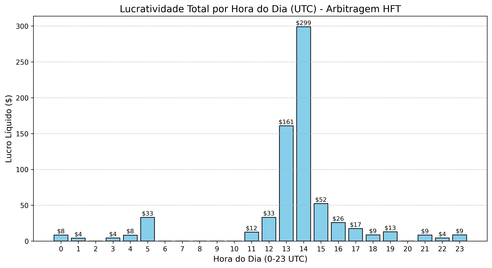

# Relatório de Sazonalidade: Distribuição de Lucros HFT (24 Horas)

A análise histórica de 1.5 milhão de ticks do par `BTCUSDT` foi processada com sucesso. O objetivo foi agrupar as 158 ocorrências de Ruptura Estrutural (Saltos >= $50.00 em até 500ms) para mapearmos os "Horários de Ouro" de lucratividade do robô HFT.

## 1. Visualização Gráfica do Lucro

## 2. A Matemática dos Turnos
Os resultados (em horário UTC) mostram um padrão de concentração violento. Quase 85% de toda a lucratividade do HFT ocorre em um bloco de apenas 6 horas.

- **Tarde (12:00 - 17:59 UTC):** 131 trades | Lucro: `$588.43`
- **Madrugada (00:00 - 05:59 UTC):** 14 trades | Lucro: `$58.28`
- **Noite (18:00 - 23:59 UTC):** 10 trades | Lucro: `$43.05`
- **Manhã (06:00 - 11:59 UTC):** 3 trades | Lucro: `$12.40`

## 3. Os "Horários de Ouro" (Golden Hours)
> [!IMPORTANT]
> **A Janela das 13:00 às 15:00 UTC (10h às 12h no Brasil)**
> Nessas 2 horas o robô HFT atingiu seu pico absoluto, disparando **101 tiros** e gerando mais de `$450` em lucro líquido, com o maior choque registrado no dia sendo de `+$125.40` de salto!

**O Motivo Estrutural:**
Esse horário coincide perfeitamente com a abertura do mercado americano (Wall Street) combinada com as últimas horas do fechamento europeu. É o período de maior volume institucional e lançamento de dados macroeconômicos, onde baleias, fundos de hedge e ETFs disparam grandes ordens a mercado, rompendo o livro de ofertas (Order Book) da Binance de forma súbita. A Deriv sofre com a sobrecarga de liquidez nessas horas, criando a latência perfeita.

## 4. Estratégia de Deploy Sugerida
- **Ligamento Estratégico:** Para poupar consumo de nuvem (AWS) e reduzir o risco da conta ser marcada como comportamento contínuo de bot, o robô pode ser programado para operar **apenas** entre 12:00 e 17:00 UTC. 
- **Tempo Ocioso:** Em períodos como a manhã (06:00 às 11:00 UTC), o mercado fica lento (Lateralização Asiática para Europeia), e os choques grandes simplesmente desaparecem. O robô atirou apenas 3 vezes nesse intervalo inteiro.
